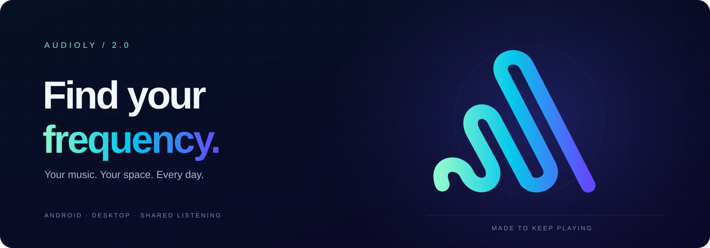
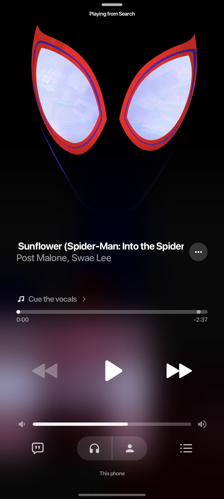
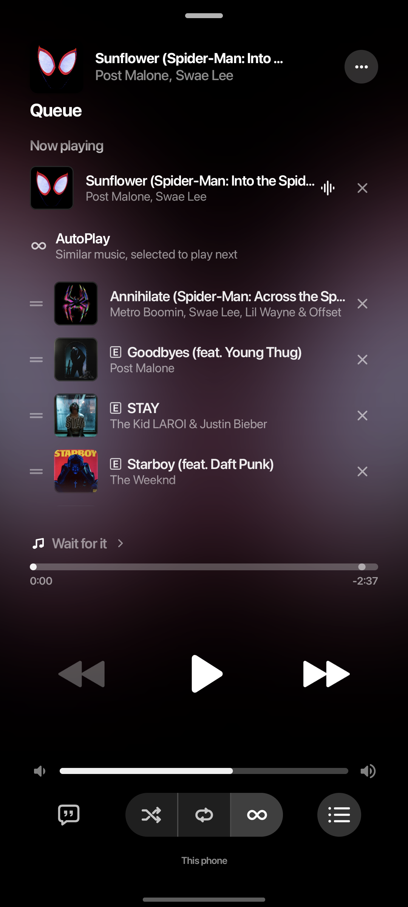
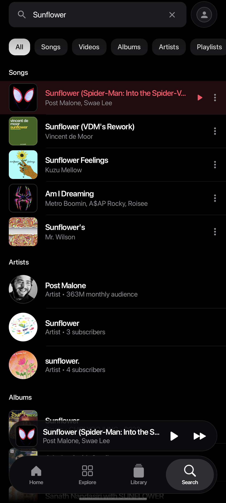

<p align="center"></p>

<p align="center">
  <strong>Your music. Your space. Your frequency.</strong><br />
  Discover your next favourite. Bring your playlists. Share the moment.
</p>

<p align="center">
  <a href="https://github.com/audioly-music/Audioly/releases/latest"><strong>Download for Android</strong></a> ·
  <a href="https://audioly.me">Website</a> ·
  <a href="#a-little-more-than-play">Features</a> ·
  <a href="#build-it-yourself">Build</a> ·
  <a href="docs/PUBLISHING.md">Publishing guide</a>
</p>

<p align="center">
  
  
  
</p>

## Find your frequency

A full-screen player that follows the artwork. Playlists that feel at home. Lyrics, a flexible queue, and a library that travels with you.

<p align="center">
  
  
  
</p>

<p align="center"><sub>Player · Queue · Discovery — real Audioly screens, captured on Android.</sub></p>

## A little more than play

<table>
<tr>
<td width="50%" valign="top">

### A sound of your own

- Browse and search the YouTube Music catalogue.
- Shape the flow with gapless playback and adjustable crossfade.
- Try Automix for beat-aware transitions. **Beta.**
- Save tracks for offline listening and play local audio.
- Keep listening in the background or through Android Auto.

</td>
<td width="50%" valign="top">

### A player that feels alive

- Colours drawn from the artwork you're listening to.
- Animated Canvas artwork when available.
- Synchronized lyrics, including word timing where supported.
- A flexible queue, sleep timer, and playback speed controls.
- Equalizer access and separate Wi-Fi/mobile quality preferences.

</td>
</tr>
<tr>
<td width="50%" valign="top">

### Bring your collection

- Connect Spotify for playlists and Liked Songs on Android.
- Import supported public playlist links.
- Keep favourites, local music, and listening history close.
- Connect supported scrobbling and presence services in settings.

</td>
<td width="50%" valign="top">

### Share the moment

- Create a Listen Together party with a shared queue.
- Invite friends with a room code or an Audioly link.
- Host your own party backend with the deployment guides.
- Parties require a running server and a network connection.

</td>
</tr>
</table>

Lossless audio requires a compatible configured module source. Lyrics, artwork, downloads, and account access depend on provider availability.

### How Spotify playback works

Spotify supplies catalog and playlist information. Audioly matches those tracks to a playable YouTube source; it does **not** stream Spotify's protected audio. Track matching requires a YouTube Music lookup before playback. Private library features require connecting your Spotify account; upstream changes and rate limits can affect availability.

See [Spotify integration notes](docs/SPOTIFY_INTEGRATION.md) for implementation details and current limitations. Audioly is an independent project and is not affiliated with Spotify, Apple, Google, or YouTube.

## Get Audioly

**[Download the latest signed Android APK →](https://github.com/audioly-music/Audioly/releases/latest)**

1. Download **Audioly.apk** from the release assets.
2. Open it and approve Android's installation request. Enable “Install unknown apps” for your browser or file manager if asked.
3. Open **Audioly** and start listening.

Android **8.0 or newer**. Official releases install as **Audioly**, with package `com.music.audioly`. Verify downloads with the release checksum. Visit [audioly.me](https://audioly.me) for the website.

### Moving from Audioly Dev

> [!IMPORTANT]
> **The public Dev channel is retired.** Move to Audioly 2.0.0 or newer. Export your settings and listening history from Dev, install Audioly, restore the backup, and sign in again. Keep Dev until you have checked your data: downloaded audio, local playlists, and account sessions are not included in the backup.

Early Dev builds cannot receive an automatic notice because their update feed was disabled. Newer Dev builds with the GitHub feed can show an update prompt. A separate **Audioly Upgrade** helper requires migration after installation and must use the original Dev signing key. See the [migration guide](docs/PUBLISHING.md#retired-dev-channel).

## Build it yourself

Requirements: **JDK 21** (Android bytecode targets Java 17), Android SDK **37** (target SDK 36), and the CMake/NDK components requested by Gradle. Minimum supported Android version: **8.0 / API 26**.

1. Open the repository in Android Studio and let Gradle sync.
2. Set your SDK path in `local.properties` if Android Studio has not created it. Optional configuration is shown in `local.properties.example`.
3. Build and test:

```bash
./gradlew :app:testDevDebugUnitTest :app:assembleProdDebug
```

On Windows, use `gradlew.bat`. Local debug APKs are written to `app/build/outputs/apk/prod/debug/`; public downloads use the signed release build.

| Variant | Application ID | Purpose |
| --- | --- | --- |
| Dev | `com.dev.audioly` | Retired-channel migration, labelled Audioly Upgrade. |
| Prod | `com.music.audioly` | Distribution builds. |

For a production build, run `./gradlew :app:assembleProdRelease`. Configure your own `keystore.properties` from the example before distributing it; without signing configuration the release output is unsigned. Keep the same signing key for future updates.

Audioly is now **2.0.0**. Versions are controlled by `version.properties` and
`python scripts/release_version.py bump`: **2.0.9 → 2.1.0**, **2.9.9 → 3.0.0**.
See the [Dev migration instructions](docs/PUBLISHING.md#retired-dev-channel) before moving an old Dev installation.

## Project map

```text
app/          Android application, Compose UI and playback
desktopApp/   Windows, Linux and macOS desktop application
shared/       Shared models, networking and playback logic
sharedUi/     Shared Compose player and UI components
native/       Audio analysis and DSP code
backend/      Go Listen Together server
deployment/  Server and website configuration examples
docs/        Integration notes, publishing guide and screenshots
```

The party backend and website are optional for local development. See [backend documentation](backend/README.md) and [deployment instructions](deployment/README.md). Deployment requires your own infrastructure and credentials; CI never deploys automatically.

## Desktop

Audioly includes a Compose desktop application for **Windows, Linux, and macOS**. Building requires **JDK 21**; packaged applications include their own runtime. Desktop packages are built through the desktop workflow; Android APK releases do not include desktop installers. See [DESKTOP.md](DESKTOP.md) for build commands. Desktop Spotify currently supports Canvas setup; the connected playlist browser is Android-only.

## Contributing

Bug reports should include the app version, Android version, steps to reproduce, and relevant redacted logs. Avoid posting cookies, tokens, private playlists, or signing files. See [CONTRIBUTING.md](CONTRIBUTING.md).

## Maintainer

Audioly is developed and maintained by **Naishal Dave**.

[Website](https://naishaldave.com) · [GitHub](https://github.com/davenaishal) · [LinkedIn](https://www.linkedin.com/in/naishaldave)

## License

Distributed under [GPL-3.0](LICENSE). See [license notices](NOTICE.md).
