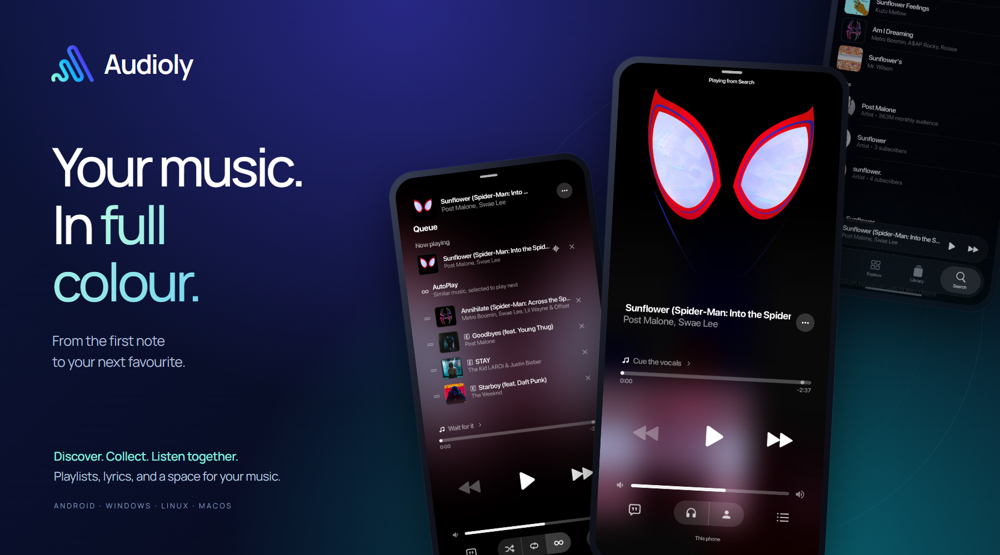
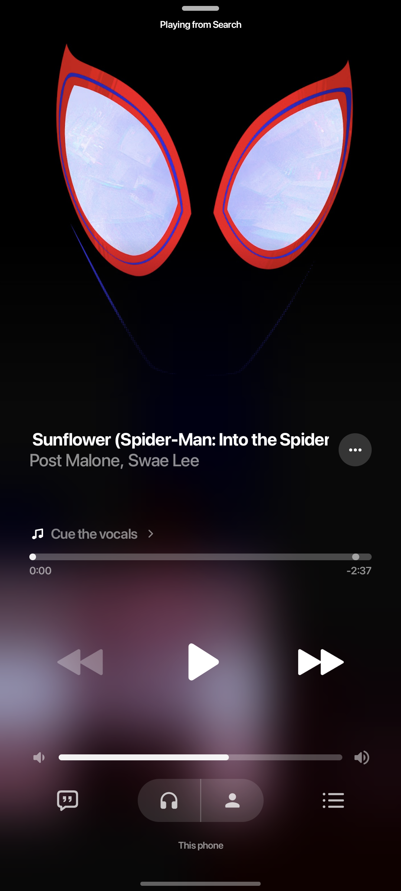
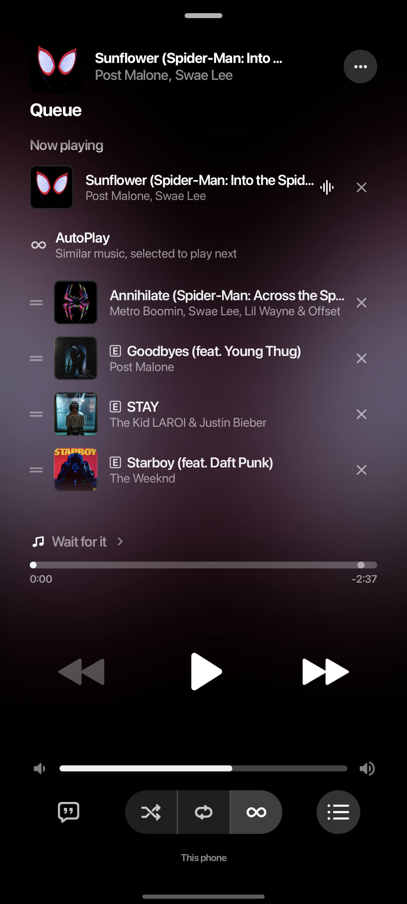
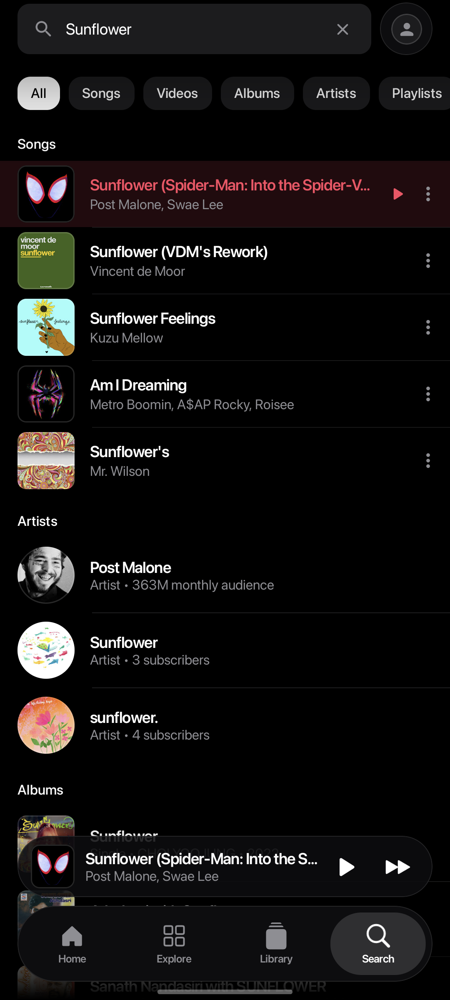

<p align="center"></p>

<p align="center"><strong>Your music. In full colour.</strong><br />An open-source music player for your phone, TV, desktop, and browser.</p>

<p align="center">
  <a href="https://audioly.me/downloads.html"><strong>Download Audioly</strong></a> &nbsp;·&nbsp;
  <a href="https://open.audioly.me/">Web player</a> &nbsp;·&nbsp;
  <a href="https://audioly.me/">Website</a> &nbsp;·&nbsp;
  <a href="#the-experience">Features</a> &nbsp;·&nbsp;
  <a href="#development">Build from source</a>
</p>

<p align="center">
  <a href="https://github.com/audioly-music/Audioly/releases/latest"></a>
  
  <a href="LICENSE"></a>
</p>

## Meet Audioly

Discover your next favourite, bring your playlists, and make the queue your own. Audioly combines an artwork-driven player, synchronized lyrics, offline listening, and shared listening parties in one place.

## Get Audioly

Choose your platform. Official downloads and checksums are available on the **[latest release](https://github.com/audioly-music/Audioly/releases/latest)**.

| Platform | Download | Requirements |
| :--- | :--- | :--- |
| **Android** | [Audioly.apk](https://github.com/audioly-music/Audioly/releases/latest/download/Audioly.apk) | Android 8.0+ |
| **Android TV** | [AudiolyTV.apk](https://github.com/audioly-music/Audioly/releases/latest/download/AudiolyTV.apk) | Android TV 8.0+ |
| **Windows** | [Setup, MSI or portable ZIP](https://audioly.me/downloads.html#windows) | x64 |
| **macOS** | [DMG, PKG or ZIP](https://audioly.me/downloads.html#macos) | Apple Silicon and Intel builds |
| **Linux** | [AppImage, DEB or RPM](https://audioly.me/downloads.html#linux) | x64 |
| **Web** | [Open Audioly](https://open.audioly.me/) | Desktop browser with the [Audioly extension](https://open.audioly.me/extension) |

On Android, open the downloaded APK and allow installation from your browser or file manager when prompted. Public builds install as **Audioly**, not Audioly Dev. Desktop packages include their own Java runtime.

<details>
<summary><strong>Checksums and moving from Audioly Dev</strong></summary>

Use `Audioly.apk.sha256` for Android, `AudiolyTV-SHA256SUMS.txt` for TV, and `Audioly-desktop-SHA256SUMS.txt` for desktop downloads.

The public Dev channel is retired. Export supported settings and history, install Audioly, restore your backup, and sign in again. Keep Dev until you have checked your data: downloaded audio, local playlists, and account sessions are not included in the backup. See the [migration guide](docs/PUBLISHING.md#retired-dev-channel).

</details>

## The experience

<p align="center">
  
  
  
</p>
<p align="center"><sub>Player · Queue · Discovery — real Audioly screens on Android.</sub></p>

| Made for listening | Made to feel like yours |
| :--- | :--- |
| **Discover** — browse and search the YouTube Music catalogue. | **Immersive player** — artwork colours and animated Canvas where available. |
| **Keep the flow** — gapless playback, crossfade, and experimental Automix. | **Follow the lyrics** — synchronized lyrics, with word timing where supported. |
| **Bring your music** — offline downloads and local audio. | **Take control** — flexible queue, sleep timer and playback speed. |
| **Listen together** — invite friends to a party with a shared queue. | **Connect your library** — Spotify playlists and Liked Songs on Android. |

Features vary by platform and source. Lossless playback requires a compatible configured module. Lyrics, artwork, downloads and account integrations depend on provider availability. Listen Together requires a network connection and a running server.

<details>
<summary><strong>About Spotify and the web player</strong></summary>

Spotify supplies playlist and catalogue information. Audioly matches tracks to a playable YouTube source; it does not stream Spotify's protected audio. Private library access requires connecting your account. Provider changes and rate limits can affect availability. See [Spotify integration notes](docs/SPOTIFY_INTEGRATION.md).

The web player needs the Audioly browser extension for playback and supported integrations. It is not an extension-free mobile web player. Follow the [extension setup guide](https://open.audioly.me/extension).

Audioly is independent and is not affiliated with Spotify, Apple, Google or YouTube.

</details>

## Development

Requirements: **JDK 21** (Android bytecode targets Java 17), Android SDK **37** (target SDK 36), and the CMake/NDK components requested by Gradle. Minimum supported Android version: **8.0 / API 26**.

1. Open the repository in Android Studio and let Gradle sync.
2. Set your SDK path in `local.properties` if Android Studio has not created it. Optional configuration is shown in `local.properties.example`.
3. Build and test:

```bash
./gradlew :app:testDevDebugUnitTest :app:assembleProdDebug
```

On Windows, use `gradlew.bat`. Local debug APKs are written to `app/build/outputs/apk/prod/debug/`; public downloads use the signed release build.

| Variant | Application ID | Purpose |
| --- | --- | --- |
| Dev | `com.dev.audioly` | Retired-channel migration, labelled Audioly Upgrade. |
| Prod | `com.music.audioly` | Distribution builds. |

For a production build, run `./gradlew :app:assembleProdRelease`. Configure your own `keystore.properties` from the example before distributing it; without signing configuration the release output is unsigned. Keep the same signing key for future updates.

Release metadata lives in `version.properties`. See the [publishing guide](docs/PUBLISHING.md) for version bumps, signing, and release workflows.
See the [Dev migration instructions](docs/PUBLISHING.md#retired-dev-channel) before moving an old Dev installation.

## Explore the project

| Resource | What you’ll find |
| :--- | :--- |
| [Desktop guide](DESKTOP.md) | Desktop builds and packaging |
| [Web player](web/README.md) | Web development and browser extension |
| [Addon documentation](https://audioly.me/docs/) | Extending Audioly with sources |
| [Backend](backend/README.md) · [Deployment](deployment/README.md) | Hosting Listen Together and the website |
| [Publishing guide](docs/PUBLISHING.md) | Signing, versioning and releases |
| [Contributing](CONTRIBUTING.md) | Contributing code and useful bug reports |

```text
app/          Android application
tv/          Android TV application
desktopApp/  Windows, macOS and Linux application
web/         Web player and browser extension
shared/      Shared models, networking and playback logic
sharedUi/    Shared Compose components
native/      Audio analysis and DSP
backend/     Listen Together server
deployment/  Website and server configuration
```

## Contributing

Found a bug or have an idea? [Open an issue](https://github.com/audioly-music/Audioly/issues). Include your app version, device or operating system, and steps to reproduce. Redact cookies, tokens and other private information from logs. Please read the [contribution guide](CONTRIBUTING.md) before submitting a pull request.

## Maintainer

Maintained by **Naishal Dave**.
[naishaldave.com](https://naishaldave.com) · [GitHub](https://github.com/davenaishal) · [LinkedIn](https://www.linkedin.com/in/naishaldave)

## License

Distributed under [GPL-3.0](LICENSE). See [license notices](NOTICE.md).
